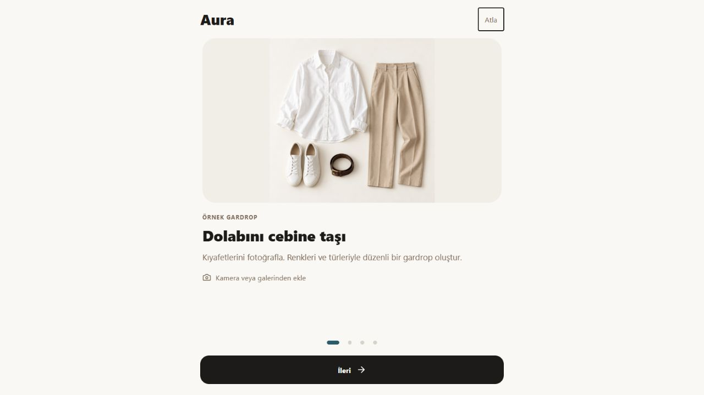
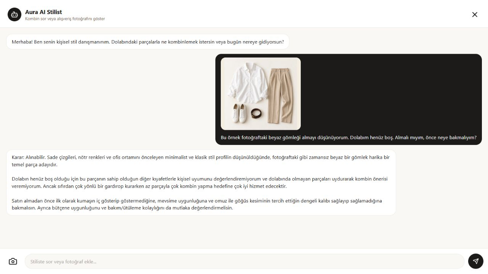

# AuraAI

**Your wardrobe. Your style. Your next outfit.**

A mobile-first AI wardrobe and personal styling app built with Expo and React Native, with a browser demo hosted on Cloudflare. Add your clothes, discover your style, and explore outfit ideas using pieces you already own.

**[Open the live demo →](https://shrill-dawn-2c7b.aura-closet.workers.dev/)** · [Screenshots](#screenshots) · [Features](#features) · [Quick start](#quick-start)

## Screenshots

### Explore a look, then make it your own

Browse outfit photos, filter by style, and ask Aura to match a reference image with clean items from your wardrobe. You can also select your own inspiration photo.


<table>
  <tr>
    <th>Home & color palette</th>
    <th>Your style profile</th>
  </tr>
  <tr>
    <td></td>
    <td></td>
  </tr>
</table>

Screenshots show the actual application with its Turkish interface. The app also supports English. The home screen shows an empty wardrobe and a sample palette; the profile result uses demonstration answers.

<details>
  <summary>First-run tour & shopping assistant</summary>
  <table>
    <tr><th>A quick introduction</th><th>Ask before you buy</th></tr>
    <tr>
      <td></td>
      <td></td>
    </tr>
  </table>
  <p>The wardrobe illustration is generated example imagery. The shopping screenshot shows a real AI response with demonstration preferences and an empty wardrobe. Shopping candidates are not automatically added to the user's wardrobe.</p>
</details>

## Try the demo

1. Open **[AuraAI](https://shrill-dawn-2c7b.aura-closet.workers.dev/)** in your browser and follow or skip the introductory tour.
2. Tap **Stilini Bul / Find Your Style** and answer five questions to create your profile.
3. Open **Dolap / Closet** to add a clothing photo from your camera or gallery.
4. Explore **İlham / Explore** to browse looks and match one with your wardrobe.
5. Open the stylist chat, attach a camera/gallery photo, and ask whether a potential purchase fits your wardrobe. Include the price and your budget when relevant.

Camera behavior depends on your device and browser; desktop browsers may open a file picker. AI features require the backend services to be available.

## Features

- **Swipeable introduction:** four short screens with sample wardrobe imagery, next/back/skip controls, and a replay option in Profile. Completion is remembered on the current device/browser.
- **Shopping photo assistant:** attach and preview a potential purchase, ask for wardrobe/style compatibility, and continue the conversation about the same photo. Failed requests can be retried without reselecting it.
- **Digital wardrobe:** add clothing photos, analyze their category, color, style and pattern, and organize favorites and laundry status.
- **Five-question style profile:** record your aesthetic, fit, color preferences, usual occasions and outfit priorities. The profile includes primary and secondary styles and informs outfit suggestions and stylist chat.
- **AI outfit suggestions:** combine clean wardrobe items using your profile, weather context and favorites. Returned item IDs are checked against the available wardrobe.
- **Photo inspiration:** browse a credited Unsplash selection or select your own reference photo for visual matching. Pinterest opens an external search; the gallery is not a live Pinterest feed.
- **Selfie color suggestions:** request an approximate palette based on a selfie. The initial palette is a sample, and lighting and camera settings affect the analysis.
- **Outfit boards and planning:** save looks to boards and plan outfits for the week.
- **Turkish and English:** switch the application language and keep your wardrobe and preferences on the current device/browser.

## Built with

| Layer | Technology |
| --- | --- |
| App & web interface | Expo, React Native, React Native Web, React |
| Styling assistance | Gemini through a Cloudflare Worker proxy |
| Photo selection | Expo ImagePicker |
| Local storage | IndexedDB for web wardrobe photos; AsyncStorage for preferences and native storage |
| Background removal | FastAPI, ONNX Runtime, U²-Net |
| Web hosting | Cloudflare |

## Quick start

Tested with Node.js 24 and npm.

```bash
git clone https://github.com/doaduran/AuraAI.git
cd AuraAI/mobile
npm install
npm run web
```

For Expo Go or a native development workflow, run `npm start` instead.

For your own backend deployment, set `EXPO_PUBLIC_PROXY_URL` in `mobile/.env` to your Worker URL and configure the Worker and background removal service using their setup guides below. Gemini credentials belong in the Worker configuration, not in the frontend.

### Checks and web export

Run these commands inside `mobile/`:

```bash
npm test
npm run build:web
```

The automated suite covers all 1,536 possible style-test answer combinations, photo selection and sequential queues, photo resizing, safe wardrobe storage migration, ordered saves and retries, shopping-image messages, AI response handling and wardrobe item validation.

For manual Cloudflare deployment, upload **one folder or one ZIP** containing the complete web export: `_expo/`, `assets/`, `index.html` and `metadata.json`. In a ZIP, `index.html` must be at the archive root.

Web wardrobe photos are resized to at most 1024 pixels before analysis and stored in IndexedDB, with an automatic migration from the previous localStorage record. Storage failures are shown in the interface. This remains device-local storage, not a cloud backup. Gallery photos can be selected together and processed sequentially while the app stays usable. Background removal has a 12-second timeout and falls back to the resized original; wardrobe analysis has a 35-second timeout, with failed photos kept in memory for retry during the current session.

The API proxy pins the verified Gemini model and requires a single clothing object
through a response schema. Each model attempt has a 12-second limit, with one
fallback model rather than repeated long retries. Proxy checks can be run from
the repository root with `node --test worker/tests/*.test.cjs`.

`mobile/wrangler.toml` also supports direct deployment to the existing web Worker:
after a web export and Cloudflare login, run `wrangler deploy --keep-vars` inside
`mobile/`. The separate API Worker is configured under `worker/`; the live Render
background service deploys from [aura-bg-removal](https://github.com/doaduran/aura-bg-removal).

## Repository structure

| Path | Purpose |
| --- | --- |
| [`mobile/`](mobile/) | Application source, style test and tests |
| [`worker/`](worker/) | Cloudflare proxy for Gemini and background removal; [setup](worker/README.md) |
| [`backend/`](backend/) | Background removal service; [setup](backend/README.md) |
| [`docs/images/`](docs/images/) | Application screenshots used in this README |

Application files live under `mobile/`. Generated exports and dependencies are excluded from Git.

## Project status

AuraAI is an evolving prototype. The interface and automated checks have been verified, while recommendation quality still needs evaluation with real wardrobes and photos. AI requests may be unavailable when the upstream model is busy or rate limited. A personal style profile is calculated from explicit questionnaire answers; it is not a separately trained model.

The inspiration gallery uses Unsplash photos with photographer/source links in the app. Photo credits are visible in the gallery screenshot above.

## License

[MIT](LICENSE)
